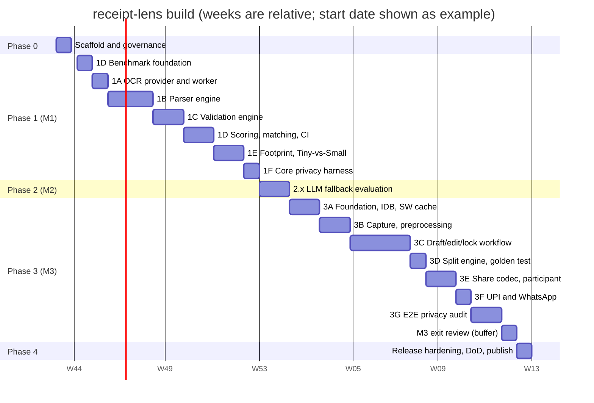

# receipt-lens — Implementation Roadmap

> Task-level execution plan that turns the **consolidated v0.4 specification** into shipped v1:
> an in-browser OCR core, a reproducible CORD/SROIE benchmark harness, CI-enforced privacy
> proofs, and a UPI-ready bill-splitting PWA.
>
> **Execution model:** solo builder · 35 h/week · 22-week single track · ~730 planned task
> hours against 770 h capacity (~5% explicit slack).
>
> Source of truth: `PROJECT.md` (Consolidated v0.4 specification). This roadmap only sequences
> it — it never overrides a locked decision (DQ-01…DQ-04, ADR-001…ADR-010).

---

## 1. Snapshot

| Metric | Value |
|---|---|
| Calendar | **22 weeks**, single track, full-time solo (35 h/wk) |
| Milestones | M1 (W9) · M2 (W11) · M3 (W21) · v1.0 (W22) |
| Decision gates | G1–G9 (open loops from spec §17) |
| Planned hours | ~730 h (P0 26 · P1 268 · P2 58 · P3 344 · P4 34) |
| Definition of Done | 11 items, each mapped to a verifying task |

The three product claims shape the schedule:

1. **Verifiable local processing** — privacy harnesses are CI gates (Phase 1 core, Phase 3 end-to-end), not documentation.
2. **Honest accuracy** — the null-parser benchmark harness is built *first*; README numbers are generated from committed results JSON.
3. **Measured footprint** — no size claim exists until the measurement harness produces the real table.

---

## 2. Master Timeline

*Figure 1 — 17 workstreams across 22 weeks. Dashed verticals: milestone exits (M1 W9, M2 W11,
M3 W21, v1.0 W22). Diamonds: decision gates (see §4).*

Optional Mermaid view (dates illustrative — weeks are the source of truth)

### Phase summary

| Phase | Window | Core objective | Exit artifact |
|---|---|---|---|
| P0 | W1 | Scaffold, CI skeletons, datasets, model assets | Green CI on empty repo; pinned dataset hashes |
| P1 (M1) | W2–W9 | Core parser, validation, benchmark harness, OCR footprint, core privacy | M1 exit criteria (§6 checklist) all pass |
| P2 (M2) | W10–W11 | LLM fallback evaluation and written decision | Decision memo with accuracy, size, latency, compat numbers |
| P3 (M3) | W12–W21 | PWA editing, splitting, sharing, UPI, end-to-end privacy | M3 exit criteria (§8 checklist) all pass |
| P4 | W22 | Definition of Done sweep and publication | v1.0.0 tag, npm package, deployed PWA, README tables |

### Effort distribution

| Workstream group | Planned hours | Share |
|---|---:|---:|
| P0 scaffold and governance (0.x) | 26 h | 4% |
| P1 core engine and benchmarks (1A–1F) | 268 h | 37% |
| P2 LLM fallback evaluation (2.x) | 58 h | 8% |
| P3 PWA build-out (3A–3G) | 344 h | 47% |
| P4 release hardening (4.x) | 34 h | 4% |

**Critical path:** dataset pinning + null-parser harness (W2) → parser (W4–6) → scorer (W7) →
threshold pinning + M1 exit (W9). Model assets → privacy harness → PWA service worker.
Framework gate G1 (end W11) → IndexedDB/SW foundation → all Phase 3 workstreams.

---

## 3. How to read the WBS

- Task IDs are `phase.workstream.sequence` (e.g. `1B.4`).
- Estimates are planning hours for one experienced builder and **include the accompanying tests**.
- A task is done when its acceptance criteria pass in CI.
- Spec references use `S<n>` = section n of the v0.4 specification.

---

## 4. Decision Gates (spec §17 open loops)

| Gate | Decision | Due | Recommended default |
|---|---|---|---|
| G1 | PWA framework commitment | end W11 | **Svelte 5 + Vite + TypeScript** (fallback: React 19 + Vite if ecosystem wins) |
| G2 | Verify third-party ~31 MB deployment figure | W22 | Ignore until measured; cite only own numbers |
| G3 | Keep PP-OCRv6 Tiny or move to Small | end W9 | **Keep Tiny** unless strict-metric gap is material |
| G4 | Pin CORD and SROIE snapshots, licenses, hashes | end W2 | CORD v2 official; canonical SROIE from source repo |
| G5 | UPI `pn`/`tn`/`tr` limits from primary NPCI spec | before W19 constants lock | Current tentative values, flagged unverified; keep `tr` optional |
| G6 | LLM fallback: yes or no for v1 | end W11 | **No** by default unless accuracy delta is decisive |
| G7 | Business-doc update to ItemUnit model | W1 | One-hour doc patch per ADR-005 supersession |
| G8t | Pin `tau_name`, confidence floors, round-off band | end W8 | Spec defaults (0.70 / 0.50 / ±₹0.02 band, ₹1.00 cap) unless data disagrees |
| G9 | Browser/UPI compatibility matrix scope | W20 | Chromium set + one Android browser; document limits honestly |

Gate operating rule: a gate closes with a one-page committed note; downstream tasks cite the
note instead of re-arguing. If a gate's inputs are not ready, the gate slips visibly.

---

## 5. Phase 0 — Repository Scaffold and Governance (Week 1, 26 h)

| ID | Task | Spec | Acceptance criteria | Est. |
|---|---|---|---|---:|
| 0.1 | Scaffold pnpm monorepo: workspace, packages/core, packages/pwa, benchmarks, playwright | S3 | install resolves; workspace globs correct; empty builds pass | 4 h |
| 0.2 | Toolchain: TS strict, vitest, eslint, prettier, changesets | S3 | sample test green in CI; lint clean on stubs | 3 h |
| 0.3 | Core export stubs: `OcrProvider`, `OcrResult`, `ocr()`, `parse()`, `validate()`, `extract()` | S4 | type tests compile; public surface documented | 4 h |
| 0.4 | CI skeletons: `ci.yml`, `benchmark.yml`, `privacy.yml` | S9, S16 | all trigger on PR; failures block merge | 4 h |
| 0.5 | Register `@receipt-lens` npm scope; exports map; publish dry run | S3 | dry-run artifact resolves in consumer project | 2 h |
| 0.6 | Business-doc update: `Item.assigned_to` → `ItemUnit`/`ItemUnitAssignment` | S14 | doc merged; no stale references (G7) | 2 h |
| 0.7 | Acquire CORD v2 + SROIE; SHA-256 hashes, licenses, label coverage notes | S8 | pinned manifest committed (G4 inputs) | 4 h |
| 0.8 | Self-host PP-OCRv6 Tiny det/rec + dictionary, content-hashed; manifest generator | S9 | manifest lists URL/bytes/SHA-256; served from app origin | 3 h |

**Exit:** fresh clone green in CI · three workflows enforcing · datasets pinned · model assets
verified from app origin · business doc updated.

---

## 6. Phase 1 — Core Engine and Benchmark Harness (Weeks 2–9, M1, 268 h)

### 6.1 Workstream 1A — OCR provider and worker (W3, 30 h)

| ID | Task | Spec | Acceptance criteria | Est. |
|---|---|---|---|---:|
| 1A.1 | Finalize `OcrProvider` + normalized `OcrResult`/`OcrLine`/`OcrWord` types | S4 | confidence nullable; provider/version required; no raw provider leakage | 4 h |
| 1A.2 | Worker shell: `ImageBitmap` transferables, protocol, typed `ReceiptLensError` | S3, S4 | `IMAGE_UNREADABLE` / `MODEL_LOAD_FAILED` / `RECOGNIZE_FAILED`; blank image = zero-word success | 7 h |
| 1A.3 | onnxruntime-web integration: WASM paths, det→rec pipeline, dictionary | S2, S14 | same-origin manifest assets; deterministic output | 11 h |
| 1A.4 | Line assembly: union boxes, mean of meaningful scores or null | S4 | no fabricated confidence; model-hash prefix recorded | 5 h |
| 1A.5 | Provider output snapshots for regression fixtures | S8 | regenerable by script; diffs fail CI | 3 h |

### 6.2 Workstream 1D part 1 — Benchmark foundation (W2, 32 h)

| ID | Task | Spec | Acceptance criteria | Est. |
|---|---|---|---|---:|
| 1D.1 | Harness skeleton + null-parser bootstrap, zero-score enforcement | S8, S16 | exactly 0 recall/F1/strict on non-empty sets; NaN impossible | 6 h |
| 1D.2 | CORD v2 loader (id-ID profile) + label-coverage metadata | S5, S8 | unsupported fields excluded, never null-scored | 10 h |
| 1D.3 | SROIE loader (en profile), grand-total-only contract | S8 | no company/date/address scoring anywhere | 8 h |
| 1D.4 | `OcrResult` fixture cache keyed by snapshot+provider+model hash | S3, S8 | deterministic regeneration; full keys | 8 h |

### 6.3 Workstream 1B — Parser engine (W4–6, 68 h)

| ID | Task | Spec | Acceptance criteria | Est. |
|---|---|---|---|---:|
| 1B.1 | Y-band clustering (40% median height) + price column (5% width tol), tunable constants | S5 | constants exported; stable on fixture corpus; no silent drops | 10 h |
| 1B.2 | Row classification: item/continuation/noise_header/ambiguous | S5 | headers never become phantom items | 10 h |
| 1B.3 | Continuation rule (4 conditions) | S5 | continuation P/R measurable as separate bucket | 6 h |
| 1B.4 | Quantity provenance: explicit/assumed/unresolved + warnings | S5, S7 | tentative 1 only with `assumed`; unresolved blocks downstream | 6 h |
| 1B.5 | Price provenance: detected/unresolved; `ambiguous_price_separator` | S5, S7 | multi-price rows never auto-resolved; preserved | 6 h |
| 1B.6 | Locale profiles id-ID / en / en-IN → integer paise | S5, S8 | `1,23,456.78` and `12.500` correct; no float equality | 10 h |
| 1B.7 | Label dictionary longest-first + `roundOff` + `otherCharges` | S5 | SUBTOTAL never captured by TOTAL; unknown labels preserved | 8 h |
| 1B.8 | Warnings catalog + `unclassifiedRows` preservation | S4, S6 | all codes emitted by tests; ambiguous rows keep provenance | 8 h |
| 1B.9 | Purity/determinism suite | S4 | deep-freeze input test; identical repeat runs | 4 h |

### 6.4 Workstream 1C — Validation engine (W6–7, 40 h)

| ID | Task | Spec | Acceptance criteria | Est. |
|---|---|---|---|---:|
| 1C.1 | `ValidateOptions`: two floors, critical ≤ warning | S4, S6 | invalid mixes rejected | 3 h |
| 1C.2 | Confidence scoping + receipt-wide mean + 0.5 cap on criticals | S6 | null scores skipped; caps scoped to affected items | 10 h |
| 1C.3 | Critical findings: `arithmetic_item_sum`, `arithmetic_total`, `item_without_price`, `zero_items`, `invalid_result_schema` | S6 | each fixture-triggered; coverage guard emits `items_may_be_missing` | 10 h |
| 1C.4 | Minor findings + warning re-emission; legacy code mapping | S4, S6 | canonical codes only from new code | 8 h |
| 1C.5 | Advisory mode (`strictArithmetic: false`) | S4, S6 | advisory never caps/confirms/blocks | 4 h |
| 1C.6 | Round-off band: ±0.02 match, ≤1.00 magnitude, signed | S6 | valid match = `round_off_adjusted`; larger = critical | 5 h |

### 6.5 Workstream 1D part 2 — Matching, scoring, CI (W7–8, 50 h)

| ID | Task | Spec | Acceptance criteria | Est. |
|---|---|---|---|---:|
| 1D.5 | Normalization (NFC, casefold, punct, ws) + candidate pairing with `tau_name` | S8 | lossless for meaningful words/digits; τ configurable | 12 h |
| 1D.6 | Deterministic order-respecting one-to-one DP matching | S8 | same input → same matches; no greedy path | 10 h |
| 1D.7 | Scorers: tier-1 strict + tier-2 field P/R/F1, macro averaging, null semantics | S8 | null-vs-null only where dataset marks missing | 10 h |
| 1D.8 | `benchmark.config` pinning τ/thresholds/band (G8t) + results JSON schema | S8, S17 | published results pin snapshots, hashes, τ, averaging | 6 h |
| 1D.9 | `benchmark.yml` fixtures mode + README table generation | S8 | README numbers regenerate byte-identically | 8 h |
| 1D.10 | Edge guards: empty datasets, no-applicable-fields | S8 | no NaN or misleading non-zero scores | 4 h |

### 6.6 Workstream 1E — Footprint and Tiny-vs-Small (W8–9, 34 h)

| ID | Task | Spec | Acceptance criteria | Est. |
|---|---|---|---|---:|
| 1E.1 | Artifact size inventory (models, dict, WASM, app JS, cache) | S2, S9, S16 | single reproducible JSON output | 6 h |
| 1E.2 | Cold/warm latency harness (headless browser) | S2, S16 | distributions recorded with browser versions | 8 h |
| 1E.3 | PP-OCRv6 Small through same provider; comparison run | S14, S17 | identical protocol; G3 evidence ready | 12 h |
| 1E.4 | Footprint table generator (JSON → markdown) | S16, S20 | no hand-typed sizes | 4 h |
| 1E.5 | ADR-002 decision note | S14 | committed; swap procedure reversible | 4 h |

### 6.7 Workstream 1F — Core offline/egress harness (W9, 14 h)

| ID | Task | Spec | Acceptance criteria | Est. |
|---|---|---|---|---:|
| 1F.1 | Minimal harness page for full core pipeline | S9 | standalone; independent of PWA | 4 h |
| 1F.2 | Playwright offline/egress test: precache → block → infer → assert | S9 | fails on any non-allowlisted request incl. worker | 8 h |
| 1F.3 | Wire `privacy.yml` | S9 | red pipeline on violation | 2 h |

**M1 exit checklist**

- [ ] `packages/core` importable; staged API typed and tested
- [ ] Deterministic parser metrics published from fixtures mode
- [ ] Measured footprint table generated from real artifacts
- [ ] Tiny-vs-Small evidence recorded; tier decision note committed
- [ ] Null-parser bootstrap enforced in CI
- [ ] Core inference succeeds with outbound network blocked
- [ ] Dataset snapshots, hashes, licenses pinned
- [ ] τ_name, confidence floors, round-off band pinned (G8t)
- [ ] Label coverage, normalization, thresholds, averaging documented

---

## 7. Phase 2 — LLM Fallback Evaluation (Weeks 10–11, M2, 58 h)

| ID | Task | Spec | Acceptance criteria | Est. |
|---|---|---|---|---:|
| 2.1 | Uncertain-subset taxonomy: failure types, prevalence, LLM-fixability | S16, S17 | committed taxonomy with counts | 14 h |
| 2.2 | Select one candidate small pretrained model (WASM/WebGPU) | S16 | license, runtime, integration sketch documented | 8 h |
| 2.3 | Run candidate on identical held-out examples; **no fine-tuning** | S16 | same protocol/fixtures/scoring as M1 | 16 h |
| 2.4 | Cost ledger: download size, cold/warm latency, browser compat | S16 | measured with 1E harness | 12 h |
| 2.5 | Decision memo (G6); no-fine-tuning boundary restated | S16, S17 | memo committed; v1 plan changes only via owner revision | 8 h |

**M2 exit checklist**

- [ ] Written decision with accuracy + correction-rate numbers
- [ ] Download size measured with the footprint harness
- [ ] Cold/warm latency recorded
- [ ] Browser compatibility limitations documented
- [ ] Fine-tuning explicitly remains out of scope

---

## 8. Phase 3 — PWA Build-Out (Weeks 12–21, M3, 344 h)

### 8.1 Workstream 3A — Framework, IndexedDB, service worker (W12–13, 72 h)

| ID | Task | Spec | Acceptance criteria | Est. |
|---|---|---|---|---:|
| 3A.1 | Framework decision record (G1) + app shell scaffold | S3, S17 | precache + IndexedDB design documented; shell deploys | 8 h |
| 3A.2 | IndexedDB schema v1 (bills, drafts, items, units, assignments, charges, participants) | S10 | `DB_SCHEMA_VERSION=1`; WorkingBill lossless round-trip | 10 h |
| 3A.3 | Transactional persistence layer with rollback | S10 | failed transaction leaves no partial state | 12 h |
| 3A.4 | Migration contract: sequential, abort/recover, test rig | S10 | failure aborts upgrade; no silent clears | 10 h |
| 3A.5 | SW precache: app shell + models; key `providerVersion:manifestHash` | S9 | old cache retained until new set verified | 12 h |
| 3A.6 | Model update flow: download → verify → smoke → activate | S9 | offline/failure keeps last verified cache + pending state | 12 h |
| 3A.7 | SW tests: bump, hash mismatch, partial download, offline start | S9, S16 | all four green; cleanup only after activation | 8 h |

### 8.2 Workstream 3B — Capture and preprocessing (W13–14, 40 h)

| ID | Task | Spec | Acceptance criteria | Est. |
|---|---|---|---|---:|
| 3B.1 | Camera (permission optional) + file selection | S10 | denied camera leaves usable file flow | 6 h |
| 3B.2 | Preview, rotate, crop — reversible, original preserved | S10 | cancel restores original | 8 h |
| 3B.3 | Optional deskew/contrast, conservative defaults, visible status | S10 | unreliable skew leaves image unchanged | 8 h |
| 3B.4 | Recrop/rerun loop; prior parse retained until accept/discard | S10 | no data loss on reprocess | 6 h |
| 3B.5 | Formats incl. HEIC only with tested local decoder | S10 | no upload fallback path exists | 4 h |
| 3B.6 | No default image persistence; optional retention + delete | S10 | default stores no image bytes | 4 h |
| 3B.7 | Preprocessing A/B measurement (report only) | S10 | claims backed by numbers or unclaimed | 4 h |

### 8.3 Workstream 3C — Import, drafts, edit mechanics, locking (W14–17, 76 h)

| ID | Task | Spec | Acceptance criteria | Est. |
|---|---|---|---|---:|
| 3C.1 | `mapping.ts`: ParseResult → drafts; public charges → `BillCharge[]` | S4, S10, S14 | roundOff signed; type discriminators correct | 8 h |
| 3C.2 | Draft finalization rules + unit materialization | S10 | unresolved drafts cannot finalize | 8 h |
| 3C.3 | Add-item flow (`manuallyAdded`, `user_confirmed`) | S10 | bulk finalize at lock; shares recompute | 6 h |
| 3C.4 | Edit flow: authoritative user values; `detectedLineTotal` preserved; qty change updates units | S10 | affected assignments identified before removal | 14 h |
| 3C.5 | Delete flow: single-transaction cascade | S10 | no orphan assignments; totals drop immediately | 6 h |
| 3C.6 | Recompute ordering + `validateWorkingBill` integration | S6, S10 | persist→recompute→validate→bill validate→UI; rollback on failure | 12 h |
| 3C.7 | Lock checklist: 9 blocker codes rendered by code | S10 | every blocker test-triggerable; no text parsing | 12 h |
| 3C.8 | `confirmedUnassigned` acknowledgement + visible `AdjustmentLine{unassigned}` | S10, S11, S14 | assigning clears flag in same transaction | 10 h |

### 8.4 Workstream 3D — Split engine and golden test (W17, 32 h)

| ID | Task | Spec | Acceptance criteria | Est. |
|---|---|---|---|---:|
| 3D.1 | `ExactMoney` rational on BigInt: GCD, positive denominator, JSON round-trip | S10, S11 | lossless; reduction property tests | 8 h |
| 3D.2 | Share computation: units/assignees, charges/participants, included skipped, discounts subtracted | S11, S14 | zero-item participants get charge shares; negative → blocker | 12 h |
| 3D.3 | Golden example CI test (P1 24635/3 … P5 24870/10, sum 66400 paise) | S11 | rational equality incl. shared unit + unassigned adjustment | 6 h |
| 3D.4 | Sum-invariance property tests on randomized bills | S11 | shares sum to confirmed payable total always | 6 h |

### 8.5 Workstream 3E — Share links and participant view (W17–18, 46 h)

| ID | Task | Spec | Acceptance criteria | Est. |
|---|---|---|---|---:|
| 3E.1 | Codec v1: compact JSON → pinned fflate DEFLATE → AES-256-GCM → base64url `#v1.…` | S14 | deterministic; fresh nonce; fflate pinned | 12 h |
| 3E.2 | HKDF derivation, context `receipt-lens-share-v1` | S14 | fixed test vectors | 4 h |
| 3E.3 | 8 KB whole-fragment budget meter; refuse-or-trim-labels UX | S14 | never silent truncation | 6 h |
| 3E.4 | Reader validation: version/structure/tag/size/schema; fail closed | S14 | malformed + tampered rejected readably | 8 h |
| 3E.5 | Participant view: my-share default, full-bill toggle, expiry hint | S13, S14 | view preference only; completeness disclosed | 6 h |
| 3E.6 | Stale-snapshot behaviour after unlock-edit; dated banner | S13, S14 | no revocation claimed | 6 h |
| 3E.7 | Security disclosure copy (bearer secret semantics) | S14, S19 | exact spec language on share screen + README | 4 h |

### 8.6 Workstream 3F — UPI and WhatsApp settlement (W19, 38 h)

| ID | Task | Spec | Acceptance criteria | Est. |
|---|---|---|---|---:|
| 3F.1 | `upi://pay` builder: encoding, `am` 2dp, pn≤40/tn≤50 (note truncated), tr optional ≤35 `[A-Za-z0-9]` | S12 | malformed intents impossible; tr omitted rather than violated | 10 h |
| 3F.2 | G5 NPCI verification + constants module with date | S12, S17 | locked or flagged unverified with disclosure | 4 h |
| 3F.3 | Largest-remainder settlement targeting confirmed grand total | S12 | sums exactly; ties by participant id; `share_exact` untouched | 10 h |
| 3F.4 | Creator no self-payment; zero-share = "nothing to pay" | S12, S13 | both tested | 4 h |
| 3F.5 | `wa.me` prefilled message (exact share + settlement + link) | S12 | external action separated from inference claims | 4 h |
| 3F.6 | Invariant test matrix incl. GPay/PhonePe/BHIM shapes | S12 | encoding/charset/length/decimals/zero-share asserted | 6 h |

### 8.7 Workstream 3G — End-to-end privacy audit (W19–20, 40 h)

| ID | Task | Spec | Acceptance criteria | Est. |
|---|---|---|---|---:|
| 3G.1 | Full-flow Playwright: upload→OCR→parse→review→edit→assign→split→lock→share | S9, S16 | deterministic pass on CI browsers | 10 h |
| 3G.2 | No cross-origin requests incl. first load; same-origin allowlist | S9 | any third-party request fails the run | 6 h |
| 3G.3 | Payload scans: no receipt bytes/OCR text in URLs, headers, bodies | S9 | canary data detected if leaking | 6 h |
| 3G.4 | BrowserContext-level SW handling; limits documented | S9 | coverage limits written down | 6 h |
| 3G.5 | Static scan: fetch/XHR/sendBeacon/WebSocket/EventSource/Image.src/form.action/dynamic imports | S9 | findings triaged and justified | 6 h |
| 3G.6 | Worker request coverage + audit report assembly | S9, S3 | report committed; `privacy.yml` runs audit | 6 h |

**M3 exit checklist** (W21 = exit review + remediation buffer)

- [ ] Working PWA with complete add/edit/delete/validate workflow
- [ ] Deterministic split outputs; golden table passes exactly
- [ ] IndexedDB migrations tested from every supported prior schema
- [ ] Model-cache invalidation + SW activation tested
- [ ] Share format, codec, 8 KB cap pass; stale-snapshot behaviour works
- [ ] UPI link test matrix passes; WhatsApp share works
- [ ] Documented end-to-end privacy audit with limitations
- [ ] Creator/participant views complete with acknowledgement flows

---

## 9. Phase 4 — Release Hardening and DoD (Week 22, 34 h)

| ID | Task | Spec | Acceptance criteria | Est. |
|---|---|---|---|---:|
| 4.1 | DoD sweep: verify all 11 items, log evidence links | S20 | each item signed off with proof | 10 h |
| 4.2 | README results tables from committed benchmark JSON | S8, S20 | CORD = layout bucket; SROIE = grand-total-only | 6 h |
| 4.3 | README measured footprint table from 1E JSON | S2, S20 | no unverified size claims | 4 h |
| 4.4 | Publish `@receipt-lens/core` + install smoke test | S3, S20 | `extract()` works from clean consumer project | 6 h |
| 4.5 | Production PWA deploy + device smoke test | S16 | self-hosted models served; share flow works on device | 6 h |
| 4.6 | v1.0.0 tag + honest release notes + retrospective | S16 | limitations match G9 matrix | 2 h |

### Definition of Done map (spec §20)

| # | DoD item (abbreviated) | Verified by |
|---|---|---|
| 1 | `extract()` delivers structured JSON in-browser | 4.4, 1A–1C |
| 2 | Public API test coverage (confidence, provenance, warnings, errors) | 1A–1C suites, 4.1 |
| 3 | Deterministic add/edit/delete with recomputation + provenance | 3C suite, 3G.1 |
| 4 | Unresolved drafts cannot finalize/lock; structured blockers | 3C.7, 3C.2 |
| 5 | Exact rational split engine; golden table in CI | 3D.3, 3D.4 |
| 6 | README dataset-scoped metrics with method + coverage | 4.2, 1D.9 |
| 7 | README measured footprint, no unverified claims | 4.3, 1E.4 |
| 8 | Offline/egress CI green; migrations + model cache tested | 1F, 3A.4, 3A.7, 3G |
| 9 | ADR-007 share format, 8 KB cap, honest limitations | 3E suite, 4.1 |
| 10 | UPI limits verified; settlement manual only | 3F.2, 3F.6 |
| 11 | LLM fallback decision recorded with data | 2.5 |

---

## 10. Risk Register

| ID | Risk | L | I | Early warning | Mitigation / contingency |
|---|---|---|---|---|---|
| R1 | PP-OCRv6 Tiny accuracy below usable bar on Indian receipts | M | H | W3–4 spot checks show heavy field errors | Early Small comparison (1E.3); lean on review workflow; escalate G6 with data |
| R2 | Runtime + models exceed practical download/memory budget | M | H | 1E.1 > ~15–20 MB or cold latency poor | Quantized variants; lazy model load; document trade-offs |
| R3 | Parser false positives on noisy/thermal receipts | H | M | high `ambiguous_row` volume; false arithmetic criticals | Fixture-driven tuning W5–6; preserve ambiguous rows; publish per-bucket metrics |
| R4 | Real bills exceed the 8 KB fragment cap | M | M | 3E.3 budget meter trips on ordinary bills | Compact serialization; label-trimming UX; refuse per ADR-007 — never silent truncation |
| R5 | Rational arithmetic / settlement allocation bugs | L | H | property test failures; golden drift | BigInt rational + property tests (3D.4); golden CI lock; isolated boundary conversion (3F.3) |
| R6 | IndexedDB migration loses user bills | L | H | migration rig failures; untested aborts | Sequential migrations + abort/recover (3A.4); JSON export before risky migrations |
| R7 | UPI deep links inconsistent across apps/OEMs | M | M | 3F.6 matrix failures | Per-intent invariants; `tr` optional; documented limitations; manual confirmation unaffected |
| R8 | Service-worker egress test gaps | M | H | 3G.4 coverage notes show unobservable SW traffic | BrowserContext-level handling; static scan supplement; explicit coverage limits in README |
| R9 | Solo scope creep / burnout slips critical path | M | H | two weeks >40 h or gates slipping | Gates force visible decisions; slack budget; cut 3B.7 / defer G2 before touching M1/M3 |
| R10 | Dataset snapshots/licenses unavailable | L | M | 0.7 download failures; license ambiguity | Pin early (G4); documented mirrors; disclose deviation if blocked |

Top-3 narrative: **R1** is the core product bet — early real-receipt spot checks make a
fundamental accuracy problem cheap to discover in W3–4, and M2 is the structured response.
**R8** protects the project's differentiating claim — two harnesses (1F + 3G) instead of one,
with coverage limits documented rather than overstated. **R9** is the classic solo-project
killer — gates, exit criteria, and visible slack turn slippage into a decision instead of a drift.

---

## 11. Traceability (spec section → workstreams)

| Spec area | Sections | Workstreams |
|---|---|---|
| Destination, repository, staged API | S1–S4 | 0.1–0.5, 1A, 1B, 1C |
| Parser geometry, classification, locales, labels | S5 | 1B.1–1B.9 |
| Provenance (quantity, price) | S7 | 1B.4, 1B.5, 3C.3, 3C.4 |
| Validation and arithmetic | S6 | 1C.1–1C.6, 3C.6, 3C.7 |
| Benchmarks and metrics | S8 | 1D.1–1D.10, 4.2 |
| Privacy and egress audit | S9 | 0.8, 1F, 3A.5–3A.7, 3G.1–3G.6 |
| PWA data model, edits, locking | S10 | 3A.2–3A.4, 3C.1–3C.8 |
| Splitting math | S11 | 3D.1–3D.4 |
| Settlement and UPI | S12 | 3F.1–3F.6 |
| Lifecycle and roles | S13 | 3C.7, 3C.8, 3E.5, 3E.6 |
| ADRs and open loops | S14, S17 | Gates G1–G9, 1E.5, 2.5, 0.6 |
| Milestones and DoD | S16, S20 | Exit checklists, 4.1–4.6 |

**Operating rhythm:** weekly review against the current week's table · gate check at each due
week · full exit-criteria pass at M1, M2, M3 before later-phase work begins.
